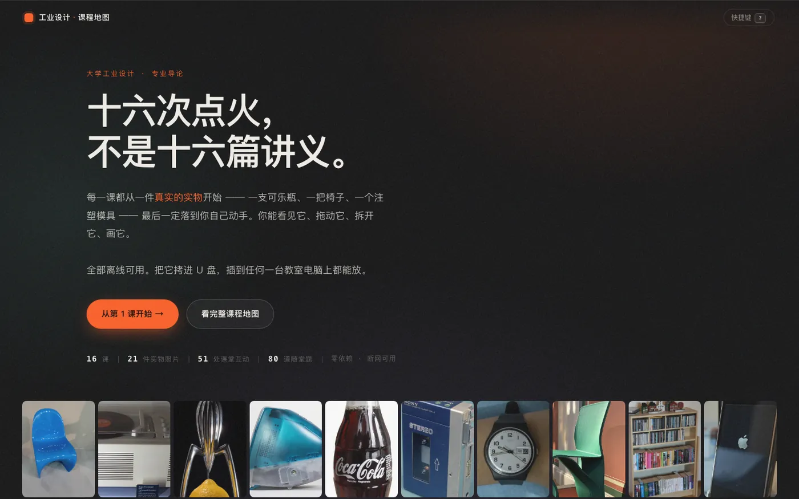
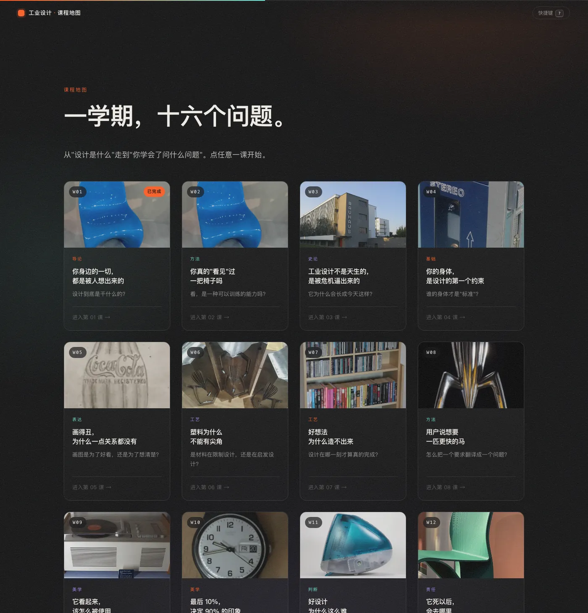

# 工业设计 · 一学期 16 课

面向大学工业设计专业的**课堂互动课件**。每一课都从一件真实的实物开始，最后一定落到学生自己动手。

### 👉 在线打开：<https://hrvs0769.github.io/industrial-design-course/>



---

## 这套课件长什么样



十六课，从「设计是什么」走到「你学会了问什么问题」。

课程使用的实物照片来自 Wikimedia Commons，依据其原始许可协议使用并逐张署名。

| | | |
|---|---|---|
| 01 设计是什么 | 02 观察力 | 03 设计史 |
| 04 人机工程 | 05 草图是思考 | 06 材料与工艺 |
| 07 结构与成本 | 08 定义问题 | 09 形态与语义 |
| 10 CMF | 11 失败博物馆 | 12 可持续设计 |
| 13 从物件到界面 | 14 AI 与设计 | 15 设计师的一天 |
| 16 学生作品展 | | |

每课都是同一副骨架：**先看见实物 → 再讲透一个概念 → 最后一定落到学生自己动手。**
里面有抽题画板、5 分钟计时器、可拖动的设计光谱、九个节点的设计史时间轴、白墙展厅式的实物陈列、以及每课 5 道带解析的随堂题。

## 关于这门课

**每一课都从一件真实的实物开始。**
一支 1915 年的可口可乐瓶、一把潘顿椅、一块榨汁机的注塑模具、一台初代 iPhone ——
先看它到底解决了什么问题，再讲透一个概念，最后一定落到学生自己动手。

**每一课都有一次当堂动手。**
抽题画板、5 分钟计时器、可拖动的设计光谱、九个节点的设计史时间轴、
白墙展厅式的实物陈列、看图识物、以及每课 5 道带解析的随堂题。
学生不是坐着听完的。

**每一课都有一次「啊？」。**
1952 年美军测了 4063 名飞行员，没有一个人符合 10 项平均尺寸；
塑料件不能有尖角，不是因为审美，是因为它会缩水开裂；
设计史上每一次变革都不是审美进步，而是被一场危机逼出来的。

## 目录

```
工业设计/
├── index.html              课程地图（首页）
├── lessons/                16 个课程页面
├── assets/
│   ├── data/01.js … 16.js  每一课的全部内容
│   ├── img/                52 张图片
│   └── …                   页面样式与交互
└── 使用说明.md              教师使用与备课说明
```

## 图片许可

课程里所有物件照片来自 [Wikimedia Commons](https://commons.wikimedia.org)，按其原始许可协议
（Public domain / CC0 / CC BY / CC BY-SA）使用。每一张的作者、协议和原始链接都自动列在
**每个页面最下方的「图片来源与许可」面板**里。

这也是课件里的一堂课：**用别人的东西，要打个招呼。**

---

## 本地使用

```bash
git clone https://github.com/hrvs0769/industrial-design-course.git
cd industrial-design-course
open index.html          # macOS
# 或者起个本地服务：python3 -m http.server 8000
```

双击 `index.html` 即可，不需要联网，不需要构建，不需要安装任何依赖。

---

*这份课件里所有东西的形状，都是某个人决定的 —— 包括每一页的字号、那根线的粗细、按钮点下去的手感。*
